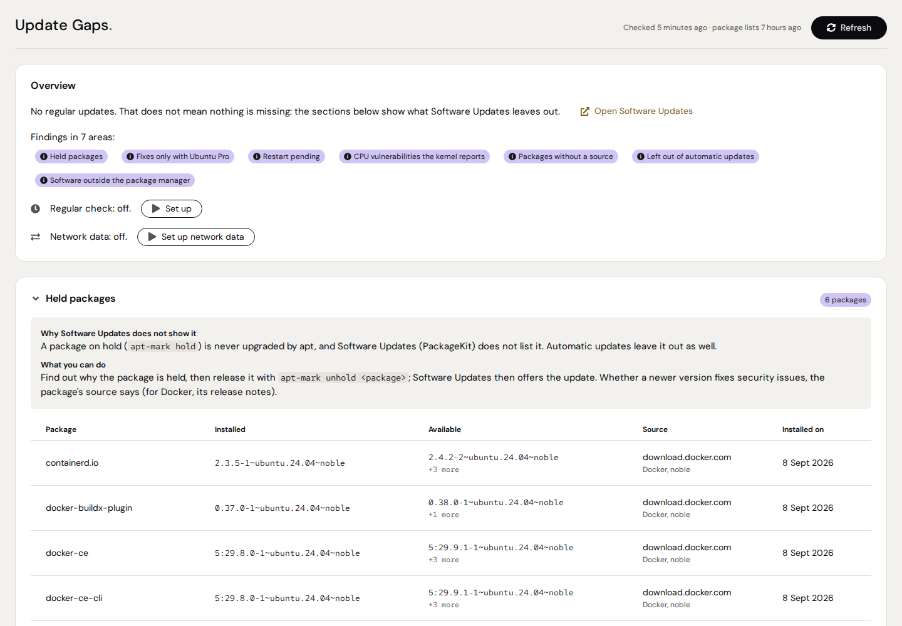
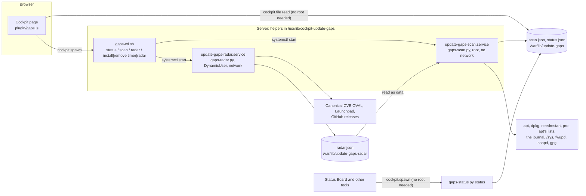

# Update Gaps

A [Cockpit](https://cockpit-project.org/) add-on that shows, per server, where updates are missing
although Cockpit's “Software Updates” lists none. For every finding it says what is missing, where
the information comes from, why “Software Updates” does not show it and what you can do. An empty
section never means “safe”: the page always says what it did not check and how old its data is.

The add-on only reads. A local service without network access checks the server and writes the
state; the page shows it. Network data (security issues Ubuntu has not fixed yet, upstream
releases) come from a separate unprivileged service, only once set up. The only changes the page
can make are to switch the add-on's own regular check and its network data on or off, after
showing what that does.



**Contents**

- [What it checks](#what-it-checks)
- [Reading the page](#reading-the-page)
- [Architecture](#architecture)
- [Security model](#security-model)
- [Requirements](#requirements)
- [Install, update, uninstall](#install-update-uninstall)
- [Settings](#settings)
- [Operation and troubleshooting](#operation-and-troubleshooting)
- [Development](#development)
- [Known limits](#known-limits)
- [License](#license)

---

## What it checks

| Area | Source on the server | Why “Software Updates” does not show it |
|---|---|---|
| **Phased updates Software Updates cannot install** (Ubuntu) | `apt-get -s dist-upgrade` (“deferred due to phasing”), `apt-cache policy`, `apt-config dump` | it lists them, but its install fails on them, and on every other update with them ([LP #1466587](https://bugs.launchpad.net/ubuntu/+source/packagekit/+bug/1466587)); the card gives the commands that work around it |
| **Packages dpkg left half done**, an interrupted dpkg | the status letters of `dpkg-query -W`, `/var/lib/dpkg/updates` | until dpkg is finished, its install fails on every update, and it only says that it failed |
| **Room for the next kernel in `/boot`**, old kernels | the kernels and their initramfs in `/boot`, the free room (`statvfs`) | a kernel update that runs out of room stops halfway and leaves dpkg half done; it only reports that it failed |
| **Held packages** and what they miss | `apt-mark showhold`, `apt-cache policy` | a package on hold is never upgraded, and PackageKit does not list it |
| **Fixes only with Ubuntu Pro** | `pro security-status --format json` | without Ubuntu Pro apt has no source for `esm-apps` and `esm-infra` |
| **Restart pending** | `needrestart -b -r l`, `/var/run/reboot-required` | on Debian and Ubuntu Cockpit does not tell when a restart is pending |
| **CPU vulnerabilities** the kernel reports, microcode, BIOS | `/sys/devices/system/cpu/vulnerabilities`, `/proc/cpuinfo`, `systemd-detect-virt`, the microcode package, `/sys/class/dmi/id` | a protection that needs microcode is no package update; in a VM only the provider can fix it |
| **Firmware updates** (with fwupd) | `fwupdmgr get-updates` from fwupd's local metadata | Cockpit has no page for firmware |
| **Snaps that are not refreshed**: held, put off, failing, on an old base | snapd's API, asked only when snaps are installed | Software Updates shows no snaps |
| **Package lists** missing, left over, old, expired, apt-daily errors | `apt-get indextargets`, `/var/lib/apt/lists`, apt's success stamp, the journal of `apt-daily.service` | the page compares with the lists on the server; without them the update is missing too |
| **Signing keys of the sources**: expired, expiring within 60 days, missing | the keyrings of `Signed-By` (else apt's trusted ones), read with `gpg --show-keys` without root | once the last key of a source has expired, apt reads that source no more and its updates drop out of every list; only `apt update` warns |
| **Packages without a source** | `apt-cache policy` | without a source there is no newer version |
| **Left out of automatic updates** | `apt-config dump` (`Allowed-Origins`, `Origins-Pattern`, `Package-Blacklist`), the origins of the sources | for apt, Cockpit shows nothing about automatic updates |
| **What the last run of the automatic updates did**: failed, missing, old, packages kept back or left for an upgrade by hand | `/var/log/unattended-upgrades/unattended-upgrades.log`, `systemctl show apt-daily-upgrade.service` | Cockpit shows nothing of the runs of unattended-upgrades |
| **Backports not installed** | `apt-cache policy` | a newer backport is offered only for a package from backports already |
| **Software outside the package manager** | `/usr/local/bin`, `/usr/local/sbin`, `/opt/*/bin`, checked with `dpkg -S` | apt does not know these files |
| **End of support** | `/usr/share/distro-info/*.csv` | Cockpit does not show when a release stops getting updates |
| **Security issues Ubuntu has not fixed yet** (network data) | Canonical's CVE OVAL of the release | without a fix there is no update to list |
| **Fixes upstream, not here yet** (network data) | GitHub releases of Cockpit, Docker, containerd, runc, Compose, restic | Software Updates compares with the package sources only |
| **Newer versions elsewhere in Ubuntu** (network data) | Launchpad: published versions per pocket and release | another pocket or a later release is not a source here |

The number of regular updates comes from `apt-get -s dist-upgrade`; the page links to “Software
Updates” for them.

**Not checked** (always listed on the page): container images (the add-on
[Image Update Monitor](https://github.com/Azentrius/cockpit-image-update-monitor) checks them),
security issues and upstream versions of packages outside the selection (with the network data
set up) or of all packages (without), Flatpaks, pip/npm/gem/cargo installs, AppImages, firmware
without fwupd, newer snap versions in the Store (snapd refreshes by itself), software in containers,
VMs and home directories, and whether a security issue applies to the configuration of the server.

## Reading the page

- **Header:** when the server was checked and when apt last updated its package lists; “Refresh”
  checks again (with administrative access) or reads the last state (without).
- **Overview:** the regular updates, the areas with findings (a click scrolls to the card), the
  regular check (off, or every 6 hours with the next run) and the network data (off, or daily with
  the time of the last fetch).
- **Cards:** one per area with findings, in a fixed order, each opened and closed through its title (the
  browser remembers which are closed): what keeps a fix back first, then the
  state of the system, then what the automatic updates cover, then the inventory. Each card has
  “Why Software Updates does not show it” (for phased updates: “Why Software Updates fails”),
  “What you can do” and the source of the data. Where a card gives commands, they are to copy
  into a terminal: the page installs nothing. A finding an earlier check saw as well says since
  when (“seen since”); the time is kept in the state file, nowhere else.
- **No findings:** the areas checked without a finding, and what was only partly checked.
- **Not checked:** what the page cannot see, plus every area that was skipped, failed or ran out
  of time on this server, with the reason.
- Hints at the top: a state older than 24 hours, packages changed after the last check, no
  administrative access.
- **In Cockpit's menu:** the entry “Update Gaps” shows the same state with Cockpit's own icon
  (blue: something to know, yellow: something to do or a state older than 24 hours, red: support
  ended, or with the network data a security issue Ubuntu rates critical) and the summary as its
  tooltip; nothing found, no icon. For this Cockpit loads the page
  hidden after the login; until you open it, it only reads `/var/lib/update-gaps/status.json` and
  checks nothing.

## Architecture



| Part | Installed to | Job |
|---|---|---|
| `plugin/` | `/usr/share/cockpit/update-gaps/` | the page (plain JavaScript, no build step), English and German; `menu-status.js` puts the state next to the menu entry |
| `lib/gaps-scan.py` | `/usr/lib/cockpit-update-gaps/` | every check, writes the state atomically |
| `lib/gapscheck.py`, `gapslib.py`, `gapsproc.py` | `/usr/lib/cockpit-update-gaps/` | the checks, the parsers, commands with time limits |
| `lib/gaps-radar.py`, `gapsradar.py` | `/usr/lib/cockpit-update-gaps/` | the network data: what to ask about, fetching, parsing (never as root) |
| `lib/gaps-ctl.sh` | `/usr/lib/cockpit-update-gaps/` | status for the page, “Refresh”, the timers |
| `lib/gaps-status.py`, `gapsstatus.py` | `/usr/lib/cockpit-update-gaps/` | the add-on's state for the Status Board, in English or German |
| `systemd/update-gaps-scan.service`, `.timer` | `/usr/lib/systemd/system/` | the check, hardened and without network; the timer is off until set up from the page |
| `systemd/update-gaps-radar.service`, `.timer` | `/usr/lib/systemd/system/` | the network data, once a day as a user of its own; off until set up from the page |

After every check the service also writes `status.json`: a short summary in the status format
all Azentrius add-ons share (unfixed security issues with the network data, held packages with
newer versions, a pending restart, CPU vulnerabilities, fixes only with Ubuntu Pro, package lists,
the end of support, regular updates, and, only when there is a finding, packages dpkg left half
done, room in `/boot`, signing keys, the runs of the automatic updates, firmware and snaps, each
with its state). The Status
Board finds the command in the page's `manifest.json` (`azentrius.status`) and runs
`gaps-status.py status --lang en|de`, which needs no administrative access; a link of an item
(`#/held`) opens this page at its card.

Interfaces, the formats of `scan.json` and `status.json` and the exit codes:
[docs/INTERNALS.md](docs/INTERNALS.md).

## Security model

- **Read only.** The scan never runs `apt update`, never installs, removes or restarts anything.
  It writes only its state files (`scan.json`, `status.json`) and its lock.
- **Network data only unprivileged, and only when set up.** The radar of stage 2
  (`update-gaps-radar.service`) runs once a day as a user of its own (`DynamicUser`, no
  capabilities, exposure 1.1) and writes only its own folder. What leaves the server: the release
  name to security-metadata.canonical.com, the names of selected source packages to
  api.launchpad.net, and which of a fixed list of projects are installed to api.github.com. The
  root scan reads its file as data, checks every value and asks only about its own selection.
- **No network for root code.** The scan runs as `update-gaps-scan.service` with
  `PrivateNetwork=yes`, `IPAddressDeny=any`, `ProtectSystem=strict` and more
  (`systemd-analyze security` exposure 4.9, checked in CI). “Refresh” starts the same service, so
  every scan runs in the same sandbox. It may write only its own folder, `/var/lib/update-gaps`;
  `pro security-status` runs as `nobody`, since as root it writes its own log and lock; `gpg`,
  which shows the keyrings of the sources, runs as `nobody` too, in a fresh home it imports
  nothing into. fwupd is
  asked over D-Bus for the metadata it already has, snapd over its socket and only when snaps are
  installed (a request would start snapd, which then goes to the Store on its own).
- **Fixed commands.** The helpers run fixed argument lists with a PATH that leaves `/usr/local`
  out (a program there can never stand in for apt), in the C locale and with time limits. The page
  calls only fixed verbs.
- **Root code in one place.** Everything that runs as root lives in `/usr/lib/cockpit-update-gaps`
  (root-owned); Python runs isolated (`-I`) and imports only from there.
- **No secrets in the state.** The state file is readable by every local user. Credentials in
  source URIs are removed; no file content is copied except the first line of a script in the
  “outside” folders, to name its interpreter, and the error lines of the last run of
  unattended-upgrades.
- **The settings file** counts only when root owns it and nobody else can write it.
- **No network from the browser.** No CDNs or external fonts (the fonts ship with the add-on);
  Cockpit's strict CSP stays unchanged.

## Requirements

- Debian 12 or newer, or Ubuntu 22.04 or newer, with systemd and **Cockpit 264** or newer
- **Python 3.8** or newer (standard library only)
- Optional, used when present (the page says what is missing): `needrestart` (services on old
  libraries), `ubuntu-pro-client` (Ubuntu Pro), `distro-info-data` (end of support, snap bases),
  `unattended-upgrades`, `gpg` (signing keys of the sources), `fwupd` (firmware),
  `systemd-detect-virt` (from systemd: tells a VM from a physical server)

Fedora, RHEL and openSUSE are not checked yet: the package installs there, and the page says so.

## Install, update, uninstall

From the Azentrius package repository (set up once, see
[packages.azentrius.com](https://packages.azentrius.com)):

```bash
sudo apt update && sudo apt install cockpit-update-gaps
```

Or from the files of a release: download the `.deb` and `SHA256SUMS`, check them, install:

```bash
sha256sum --ignore-missing -c SHA256SUMS
gh attestation verify cockpit-update-gaps_X.Y.Z-1_all.deb --repo Azentrius/cockpit-update-gaps
sudo apt install ./cockpit-update-gaps_X.Y.Z-1_all.deb
```

The package must be installed on each server you look at in Cockpit, also behind a Cockpit
bastion (the page is served by that server's bridge). After the first install, open the page with
administrative access: it checks the server once by itself. Set up the regular check there if you
want the state kept current, and the network data if you want them (see the security model for
what leaves the server).

Uninstall: `sudo apt remove cockpit-update-gaps`. It stops both timers and removes the state and
the network data; `/etc/update-gaps.conf` stays.

## Settings

`/etc/update-gaps.conf` is optional. It must belong to root and must not be writable by group or
others; an unknown key or a relative path makes the “outside” check report an error instead of
hiding anything.

```ini
# Folders or files under /usr/local/{bin,sbin} or /opt/*/bin that someone else keeps up to date.
HIDE_OUTSIDE=/opt/agent/bin
HIDE_OUTSIDE=/usr/local/bin/site-deploy
```

The page still counts what it hides and names the file.

## Operation and troubleshooting

```bash
sudo systemctl start update-gaps-scan.service           # check now (what "Refresh" does)
journalctl -u update-gaps-scan.service -n 20            # how the last check went
sudo /usr/lib/cockpit-update-gaps/gaps-scan.py | less   # the same checks, on stdout
/usr/lib/cockpit-update-gaps/gaps-ctl.sh status         # timer, admin, last package change
/usr/lib/cockpit-update-gaps/gaps-status.py status --lang de   # what the Status Board shows
sudo systemctl start update-gaps-radar.service          # fetch the network data now (once set up)
journalctl -u update-gaps-radar.service -n 20            # how the last fetch went
systemctl list-timers update-gaps-scan.timer            # the regular check
```

## Development

```bash
(cd test && npm ci)                    # jsdom for the page tests
pip install -r test/requirements.txt   # shellcheck, ruff, playwright
make check                             # every offline test
make lint                              # shellcheck, ruff, systemd units and their hardening
python3 tools/preview/build.py         # the page with recorded data:
                                       # tools/preview/out/update-gaps/index.html?scenario=noble-held&lang=en
```

The helper tests run against output recorded on real Debian and Ubuntu servers
(`test/fixtures/`, made anonymous by `test/fixtures/import_capture.py`); `test/scenarios.sh` sets
up the same situations in throw-away containers, and the CI job `cockpit` uses the page in a real
Cockpit session. More in [CONTRIBUTING.md](CONTRIBUTING.md).

## Known limits

- Only apt systems (Debian, Ubuntu) are checked. The network data cover Ubuntu; on Debian only the
  upstream releases are asked.
- Whether a newer version of a held package from a third-party source fixes security issues is not
  known locally: the page says where to look, and with the network data it names the fixes in the
  releases of a fixed list of projects.
- In a virtual machine the page sees the CPU as the hypervisor presents it: whether the provider's
  hosts have newer microcode, it cannot tell.
- Firmware only through fwupd, and only for devices whose vendor publishes on the LVFS.
- `needrestart` sees services only as root; without it the page compares the running kernel with
  the newest installed one and reads the reboot flag.
- The time of the last `apt update` comes from apt's success stamp (Ubuntu) or the mtime of apt's
  download folder; the list files' own times are the server's `Last-Modified`.
- The log of unattended-upgrades has the server's local time; the page reads it as UTC. apt-daily's
  download run (`--download-only`) writes no end to the log and is left out.
- A keyring counts as long as one of its signing keys is valid: which key a source signs with is
  not checked. A source without `Signed-By` may use any of apt's trusted keyrings, so each of them
  is shown.

## License

Apache-2.0, see [LICENSE](LICENSE). Third-party material (fonts, icons) is listed in
[NOTICE](NOTICE).
